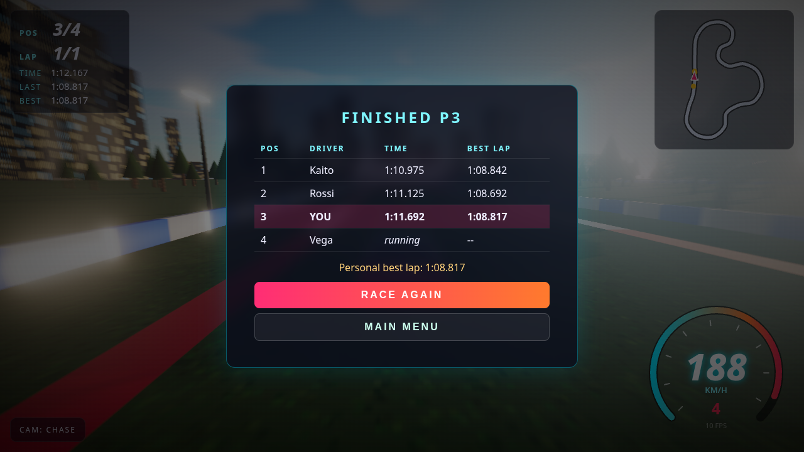

# NEON APEX

**A golden-hour circuit racer that runs entirely in the browser.** Three.js rendering with real-time shadows, bloom and speed blur, a hand-rolled tire-model vehicle simulation, AI opponents that follow a computed racing line, and a fully procedural soundtrack of engine and tires. No backend, no downloaded assets: every texture, mesh and sound is generated at runtime.


| Main menu (attract mode) | Race start |
|---|---|
|  |  |
| **TV trackside camera** | **Results** |
|  |  |

<sub>Screenshots are captured automatically in headless Chromium using SwiftShader (software GL) via `scripts/screenshots.mjs`.</sub>

## Features

**Driving model** (`src/car.ts`)
- Bicycle-model vehicle dynamics at a fixed 120 Hz step: slip angles, saturating lateral tire forces, longitudinal load transfer, and a friction circle (throttle and brakes eat into cornering grip)
- Rear-wheel drive, 6-speed automatic gearbox with a torque curve and rev limiter; RPM drives the audio
- Speed-sensitive, rate-limited steering; handbrake drops rear grip for drifts and handbrake turns
- Adjustable stability assist (lighter for the player, so slides stay catchable)
- Aero drag, rolling resistance, grass that slows you and costs grip
- Barrier collisions with restitution, scraping and camera shake; car-to-car collisions using two circles per car with off-center yaw impulses

**Track & world** (`src/track.ts`, `src/scenery.ts`)
- Closed ~2.4 km Catmull-Rom circuit: long straight, hairpin, esses, sweepers
- Road ribbon with lane markings, red/white curbs, run-off, continuous barriers, start/finish gantry, grandstand with crowd
- Instanced trees, a city skyline with lit windows, street lamps along the whole lap
- Preetham physical sky, with a PMREM environment map built from the same sky so car paint reflects it; fog and a directional sun whose shadow frustum follows the player

**Rendering & effects**
- PCF shadow maps, ACES tone mapping, Unreal bloom (lamps, head- and brake lights)
- Custom radial speed-blur and vignette pass, FOV kick that scales with speed, high-speed camera vibration
- Skid marks (instanced ring buffer) and soft tire-smoke particles (custom point shader)
- **Graphics quality setting** (Low / Medium / High): pixel ratio, MSAA, shadows, bloom, scenery density, particle budgets

**Racing**
- 0–7 AI opponents across three difficulties. The racing line is computed from track curvature, and target speeds come from a grip limit (`v = √(μg/κ)`) plus a backward braking pass. AI cars avoid each other by changing lanes and get mild rubber-banding
- F1-style 5-light countdown, lap timing, lap counter, live race position, results table
- **Best lap saved in `localStorage`**
- HUD: canvas speedometer with RPM arc and gear, minimap with every car, current/last/best lap times, FPS
- Cameras: **Chase** (spring-damped, follows the drift angle), **Bumper**, **TV** trackside cams with auto-zoom, **Orbit**
- Pause menu (resume / restart / sound / quit), auto-pause when the tab is hidden
- Attract mode: AI cars race behind the main menu

**Audio** (`src/audio.ts`): 100% procedural Web Audio. The engine is three oscillators through a resonant low-pass, with pitch following RPM and timbre opening up with throttle. Tire screech is band-passed noise driven by slip. Impacts and countdown beeps are synthesized too. Mute toggle is saved between sessions. No audio files are used, so there is nothing to attribute.

## Controls

| Action | Keyboard | Gamepad (standard mapping) |
|---|---|---|
| Throttle | `W` / `↑` | RT |
| Brake / reverse | `S` / `↓` | LT |
| Steer | `A` `D` / `←` `→` | Left stick |
| Handbrake | `Space` | A / B |
| Change camera | `C` | Y |
| Pause | `Esc` / `P` | Start |
| Mute | `M` | – |

## Running locally

```bash
npm install && npm run dev
```

Then open the URL Vite prints (usually http://localhost:5173).

Other scripts:

```bash
npm run build      # type-check (tsc) + production build into dist/
npm run preview    # serve the production build
npm run test:sim   # headless physics/AI regression: laps the circuit at 4 AI skill levels
npm run screenshots  # needs `npx playwright install chromium` and a running preview on :4173
```

Handy URL flags: `?quality=0|1|2` forces a graphics preset, and `?autopilot=1` lets the AI drive your car (used for screenshots).

## Deploying to GitHub Pages

`.github/workflows/deploy.yml` builds on every push to `main` and publishes `dist/` with the official Pages actions. It sets `BASE_PATH=/<repo-name>/`, which `vite.config.ts` uses as `base`. Local builds use a relative base (`./`), so `dist/` also works from any static host. To turn it on: push the repo to GitHub, then under **Settings → Pages → Source**, choose **GitHub Actions**.

## Tech stack

- [Three.js](https://threejs.org/) r186: rendering, post-processing (`EffectComposer`, `UnrealBloomPass`, custom `ShaderPass`), `Sky`
- TypeScript (strict) + [Vite](https://vitejs.dev/)
- Custom vehicle physics (no physics engine dependency: the planar tire model is both lighter and more tunable than a rigid-body engine for this game)
- Web Audio API, Canvas 2D (HUD and procedural textures), Gamepad API
- Playwright for automated screenshots

## Project structure

```
src/
  main.ts      game loop, state machine, AI controller, collisions, cameras, post-FX
  car.ts       vehicle dynamics + procedural car mesh
  track.ts     circuit spline, racing line, target speeds, road/curb/barrier geometry
  scenery.ts   sky, lighting, environment map, instanced scenery
  effects.ts   skid marks and tire smoke
  audio.ts     procedural engine/tire/impact audio
  input.ts     keyboard + gamepad
  hud.ts       speedometer, minimap, timing
scripts/
  screenshots.mjs  headless capture
  sim-test.ts      headless AI lap regression
```

## License

[MIT](LICENSE) © 2026 Death
