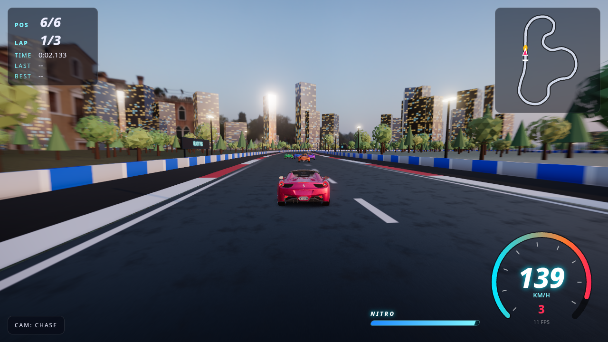
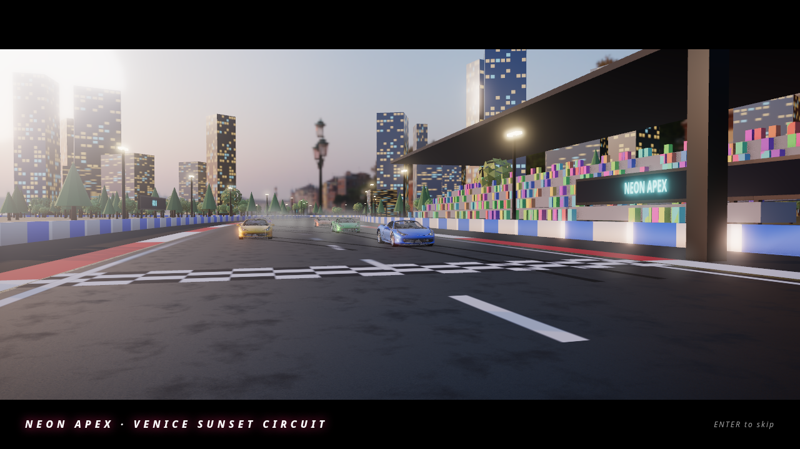
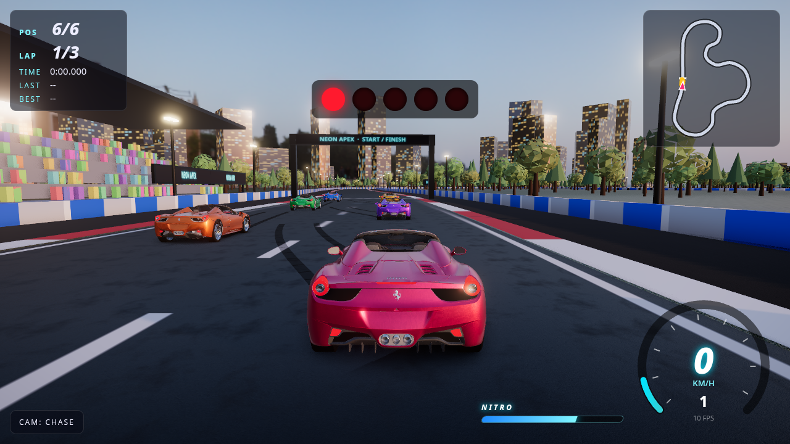
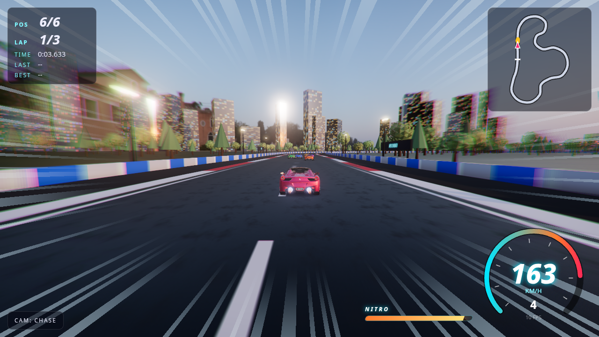
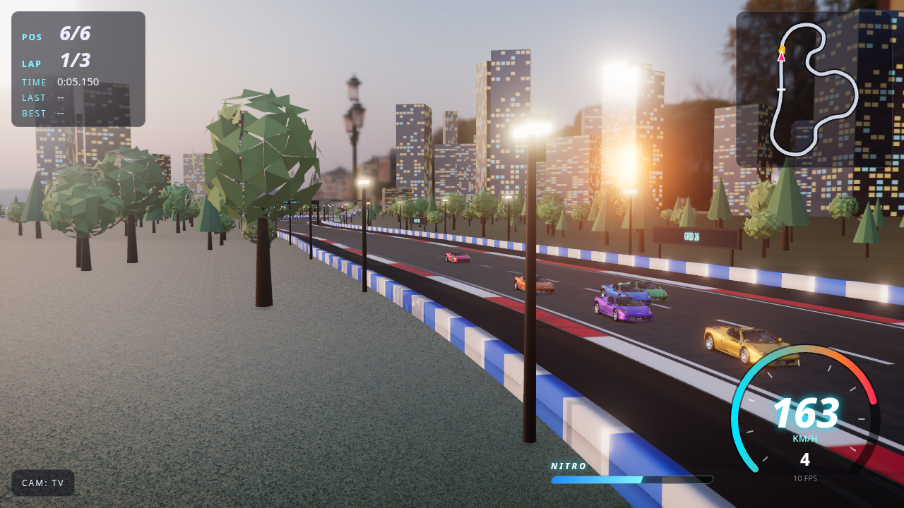
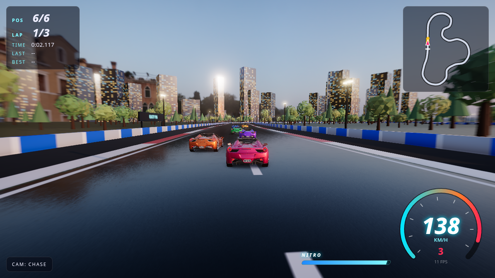

# NEON APEX

**A golden-hour street circuit racer that runs entirely in the browser.** Physically based rendering lights a licensed glTF supercar with an HDRI and fills the circuit with CC0 PBR surfaces. The full post stack includes ambient occlusion, bloom, speed blur, lens flare and optional screen-space reflections on a wet road. Under it sits a hand-written tire-model physics sim, AI rivals that follow a computed racing line, a nitro system and procedural audio. There is no backend.



| Main menu (attract mode) | Cinematic intro flyby |
|---|---|
|  |  |
| **Race start** | **Nitro boost** |
|  |  |
| **TV trackside camera** | **Wet road (SSR)** |
|  |  |

<sub>Screenshots come from headless Chromium on SwiftShader (software GL) at the High preset, captured by `scripts/screenshots.mjs`. A real GPU looks the same and runs far faster.</sub>

## Features

**Visuals**
- **Licensed glTF car** (Ferrari 458 Italia, CC BY 4.0; see [CREDITS.md](CREDITS.md)). Your car loads the full ~350k-triangle Draco model. AI cars use a meshopt-compressed LOD at about 15% of the triangles, with creased normals rebuilt at load time.
- **Car materials**: `MeshPhysicalMaterial` paint with clearcoat and a procedural **metallic-flake** normal map, chrome, tinted glass, carbon fiber, and emissive head-, tail- and **brake lights** that feed bloom. Each car has a baked contact-shadow (AO) plane.
- **HDRI lighting**: Poly Haven *Venice Sunset* (CC0) is used for the background and, through PMREM, for image-based lighting and reflections. The sun's direction is detected from the brightest texel of the HDRI, so shadows line up with the sky.
- **PBR surfaces**: ambientCG asphalt and grass (CC0, color + normal + roughness) shipped as **KTX2 / Basis Universal** with JPG fallback. Lane markings are a separate decal layer, curbs are painted, and there is asphalt run-off.
- **Wet road option**: a glossy, darker asphalt that reflects the HDRI. On High it adds an **SSR pass** (screen-space reflections) restricted to the road surface.
- **Post stack**: ACES filmic tone mapping, **GTAO** ambient occlusion (High), MSAA render targets, Unreal bloom, **speed-scaled radial motion blur** and vignette, **lens flare with an anamorphic streak** on the sun.
- **Nitro FX**: twin exhaust flames (additive animated shader), radial speed lines, chromatic fringe, extra FOV kick and a whoosh/roar sound.
- **Cinematic intro**: a letterboxed crane-and-sweep flyby over the grid before the lights. Skip it with Enter.
- **Scenery**: instanced broadleaf and conifer trees, reflective glass towers with lit windows, street lamps, tire stacks on the outside of tight corners, emissive sponsor billboards, a grandstand with crowd, and a start/finish gantry.
- **Quality tiers** (Low / Medium / High) control pixel ratio, MSAA, shadow resolution, GTAO/SSR, bloom, lens flare, HDRI resolution, car detail, scenery density and particle budgets.

**Driving model** (`src/car.ts`)
- Bicycle-model vehicle dynamics at a fixed 120 Hz step: slip angles, saturating lateral tire forces, longitudinal load transfer and a friction circle
- Rear-wheel drive, a 6-speed auto gearbox with torque curve and limiter, speed-sensitive rate-limited steering, and a handbrake for drifts
- **Nitro**: a separate thrust that bypasses traction. The tank refills slowly over time and faster while drifting, and AI cars use it on straights
- Stability assist, grass penalty, and barrier and car-to-car collisions

**Racing**
- 0–7 AI rivals on three difficulties: a curvature-based racing line, grip-limited target speeds with a braking pass, lane-change avoidance, mild rubber-banding
- 5-light countdown, lap timing and count, live positions, results table, **best lap saved in `localStorage`**
- HUD: speedometer with RPM arc and gear, **nitro meter**, minimap, lap times, FPS
- Cameras: Chase, Bumper, TV trackside (auto-zoom), Orbit
- Pause menu, auto-pause on tab hide, attract mode behind the menu

**Audio**: fully procedural Web Audio (engine with RPM pitch, tire screech, nitro roar and whoosh, impacts, beeps) with a mute toggle. No audio files are used.

## Controls

| Action | Keyboard | Gamepad (standard mapping) |
|---|---|---|
| Throttle | `W` / `↑` | RT |
| Brake / reverse | `S` / `↓` | LT |
| Steer | `A` `D` / `←` `→` | Left stick |
| Handbrake | `Space` | A / B |
| Nitro | `Shift` / `N` | X / RB |
| Skip intro | `Enter` / `Esc` | Start |
| Change camera | `C` | Y |
| Pause | `Esc` / `P` | Start |
| Mute | `M` | – |

## Running locally

```bash
npm install && npm run dev
```

Then open the URL Vite prints (usually http://localhost:5173).

Other scripts:

```bash
npm run build      # type-check (tsc) + production build into dist/
npm run preview    # serve the production build
npm run test:sim   # headless physics/AI regression: 3 laps at 5 AI skill/nitro configs; fails on any barrier contact
npm run screenshots  # needs `npx playwright install chromium` and a running preview on :4173
```

Handy URL flags: `?quality=0|1|2` forces a graphics preset, `?wet=1` turns on the wet road, `?gtao=0` disables ambient occlusion, and `?autopilot=1` lets the AI drive your car (used for screenshots).

## Deploying to GitHub Pages

`.github/workflows/deploy.yml` builds on every push to `main` and publishes `dist/` with the official Pages actions. It sets `BASE_PATH=/<repo-name>/`, which `vite.config.ts` uses as `base`. Local builds use a relative base (`./`), so `dist/` also works from any static host. To turn it on: push the repo to GitHub, then under **Settings → Pages → Source**, choose **GitHub Actions**.

## Tech stack

- [Three.js](https://threejs.org/) r186: rendering, post-processing (`EffectComposer`, `UnrealBloomPass`, custom `ShaderPass`), `Sky`
- TypeScript (strict) + [Vite](https://vitejs.dev/)
- Loaders: `GLTFLoader` + `DRACOLoader` + meshopt decoder, `KTX2Loader` (Basis Universal), `HDRLoader`
- Post: `GTAOPass`, `SSRPass`, `UnrealBloomPass`, `Lensflare`, custom speed/nitro `ShaderPass`, `OutputPass`
- Asset pipeline: glTF-Transform + meshoptimizer for the LOD, Basis Universal `basisu` for KTX2
- Custom vehicle physics (no physics engine dependency: the planar tire model is both lighter and more tunable than a rigid-body engine for this game)
- Web Audio API, Canvas 2D (HUD and procedural textures), Gamepad API
- Playwright for automated screenshots

## Project structure

```
src/
  main.ts      game loop, state machine, AI controller, collisions, cameras, post-FX
  assets.ts    asset loading (Draco/meshopt glTF, KTX2, HDR) with progress
  carmodel.ts  car materials (flake paint, chrome, glass, lights), LOD, nitro flames
  car.ts       vehicle dynamics + nitro
  track.ts     circuit spline, racing line, target speeds, road/curb/barrier geometry
  scenery.ts   HDRI lighting, sun + lens flare, PBR ground, instanced scenery
  effects.ts   skid marks and tire smoke
  audio.ts     procedural engine/tire/impact audio
  input.ts     keyboard + gamepad
  hud.ts       speedometer, minimap, timing
scripts/
  screenshots.mjs  headless capture
  sim-test.ts      headless AI lap regression
```

## Credits

Third-party assets and their licenses are listed in [CREDITS.md](CREDITS.md). The car model is **CC BY 4.0, by vicent091036**. The HDRI (Poly Haven) and PBR textures (ambientCG) are CC0.

## License

Code: [MIT](LICENSE) © 2026 Death. Bundled assets keep their own licenses (see CREDITS.md).
